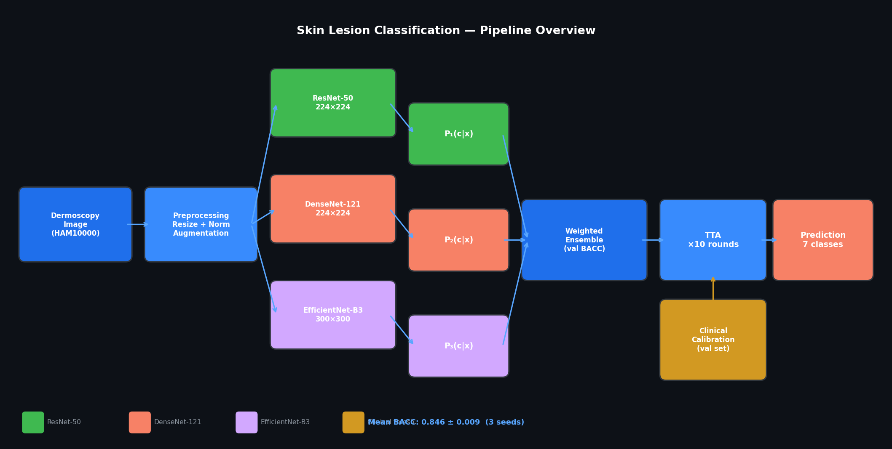
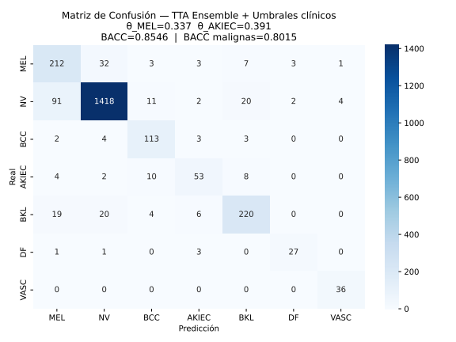
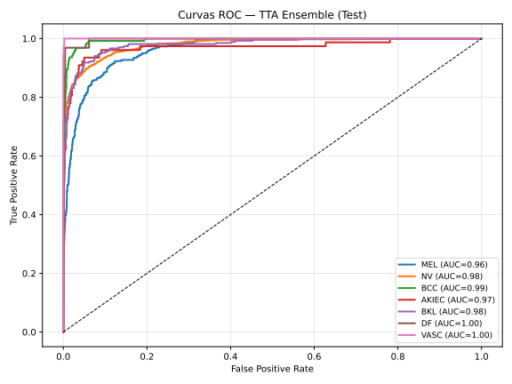
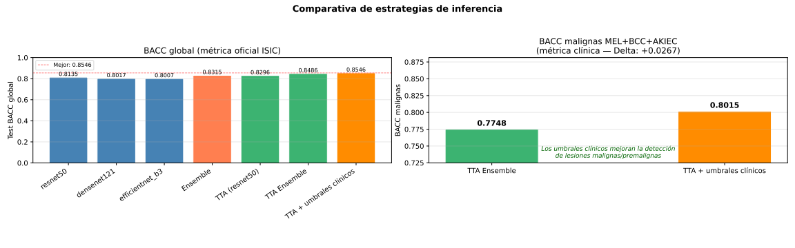
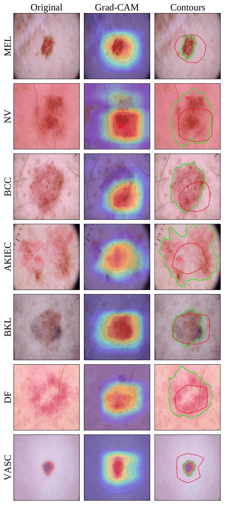
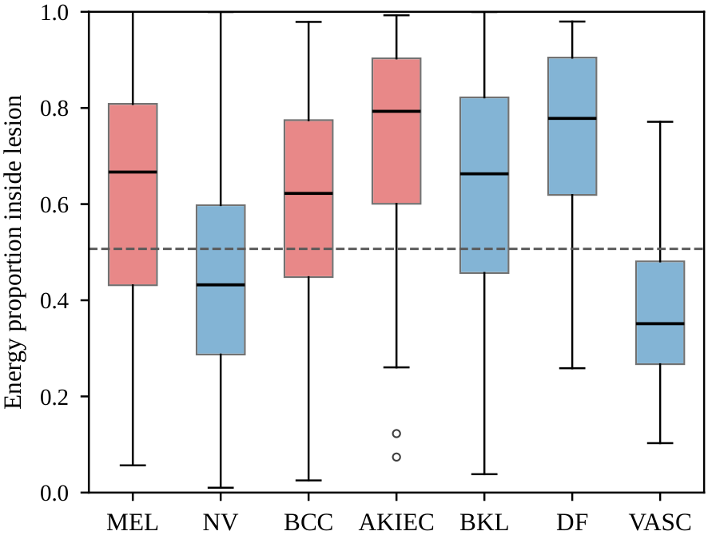
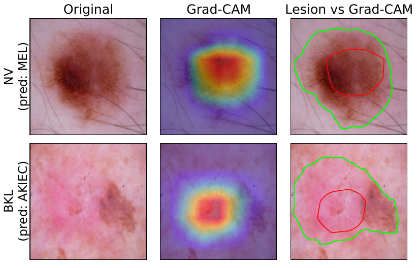

# Skin Lesion Classification with CNN Ensemble · Clinical Threshold Calibration · BACC 0.846 ± 0.009

<div align="center">


[](https://www.kaggle.com/code/danielortizrequena/cnn-ensemble-tta-clinical-thresholds-isic2018)


**Automated dermoscopy image classification for 7 skin lesion types**  
*Weighted CNN Ensemble · Test-Time Augmentation · Clinical Threshold Calibration · Grad-CAM validated against expert lesion masks · ISIC 2018 Task 3*

</div>

---

## At a glance

- **Task.** Seven-class classification of dermoscopic images (ISIC 2018 Task 3) with a validation-weighted ensemble of ResNet-50, DenseNet-121 and EfficientNet-B3, test-time augmentation and per-class clinical decision thresholds.
- **Classification.** Balanced accuracy of 0.8546 on the seed-42 reference run; the clinical thresholds raise the balanced accuracy of the malignant classes from 0.7748 to 0.8015. Across three seeds, the ensemble with test-time augmentation reaches 0.846 ± 0.009 before calibration.
- **Attention.** Over 1991 test images, the Grad-CAM energy that falls inside expert lesion masks is higher for malignant classes (0.632) than for benign ones (0.476), and missed melanomas show less lesion-focused attention than detected ones, in three backbones, the ensemble and three training seeds.
- **Caveat.** The split is by image, and 39% of the HAM10000 test images share a lesion with a training or validation image. Results on the 1212 test images without a shared lesion are reported alongside ([The split is by image](#the-split-is-by-image)).
- **Context.** Undergraduate thesis (10/10) and two conference papers; each one cites the tag that holds its code and results ([Publications](#publications)).

---

## Publications

- Ortiz Requena, D. (2026). *Clasificación automática de lesiones cutáneas mediante redes
  neuronales convolucionales*. Undergraduate thesis (TFG), Ingeniería de la Salud, Universidad
  de Málaga. Defended on 24 September 2026, grade 10/10. RIUMA link pending; the deposited
  version has an erratum, listed in [`ERRATA.md`](ERRATA.md) (Spanish), and a corrected PDF is
  attached to release `v1.1.2`. Code and results: tag `1.0`, preserved unchanged.
- Ortiz Requena, D. and Domínguez Merino, E. (2027). *Dataset-Scale Validation of Grad-CAM
  Attention Against Expert Lesion Masks in Dermoscopic Classification*. 14th International
  Conference on Bioimaging (BIOIMAGING 2027), part of BIOSTEC 2027, Valletta, Malta.
  Accepted as a short paper with oral presentation; to appear in the SCITEPRESS proceedings.
  Code and results:
  [tag `v1.2`](https://github.com/daorre1202/skin-lesion-classifier-CNN/releases/tag/v1.2).
- Ortiz Requena, D. (2026). *Clinically Calibrated Per-Class Decision Thresholds for
  High-Risk Skin Lesion Classification: A Multi-Seed Study on ISIC 2018*. XLIV Congreso
  Anual de la Sociedad Española de Ingeniería Biomédica (CASEIB 2026), València.
  Presented as an oral communication in November 2026; proceedings pending. Code and results:
  [tag `v1.1.1`](https://github.com/daorre1202/skin-lesion-classifier-CNN/releases/tag/v1.1.1).

### Versions

Training code and reported results are identical across all tags. To reproduce the results of a publication, use the tag it cites.

| Tag | Adds | Cited by |
|---|---|---|
| `1.0` | Code and results cited in the thesis | Thesis |
| `v1.0.1` | Documentation corrections to this README | |
| `v1.1` | Paired bootstrap of the calibration gain (`scripts/bootstrap_paired.py`) and the seed-42 test probabilities; corrected Mahbod et al. row | |
| `v1.1.1` | Melanoma sensitivity-target sweep (`scripts/threshold_sweep.py`) | CASEIB 2026 |
| `v1.1.2` | [`ERRATA.md`](ERRATA.md); corrected thesis PDF attached to the release | |
| `v1.1.3` | Lesion overlap between the splits (`scripts/lesion_overlap_check.py`) | |
| `v1.2` | Attention validation against expert lesion masks: notebooks 03 to 05, attention-supervision control, `scripts/attention_stats.py`, figure scripts and result files | BIOIMAGING 2027 |

---

## Overview

> **Clinical motivation:** Melanoma is the deadliest form of skin cancer, yet its 5-year survival rate exceeds 99% when detected at an early stage. Dermoscopy-based deep learning classifiers can assist dermatologists in screening, but standard accuracy metrics are insufficient for clinical use: a system that correctly classifies 95% of images while missing 30% of melanomas is clinically dangerous. This project addresses that gap by combining a weighted CNN ensemble with per-class probability threshold calibration that explicitly targets **sensitivity ≥ 0.85 for melanoma** and **≥ 0.75 for actinic keratoses**, with at most a marginal change in global balanced accuracy.

This project implements an end-to-end deep learning pipeline for the automated classification of dermoscopic skin lesion images, addressing the **ISIC 2018 Challenge Task 3** (HAM10000 dataset, 11,720 images across all splits, 7 classes). The system is designed with clinical deployment constraints in mind: beyond optimising global accuracy, it incorporates class-specific probability threshold calibration to meet clinically meaningful sensitivity targets for malignant lesions.

The pipeline combines three pretrained CNN architectures into a **weighted ensemble**, applies **Test-Time Augmentation (TTA)** at inference, and uses **Grad-CAM** to show where the models look, validated over the whole test set against expert lesion masks (see [Attention validation](#attention-validation-against-expert-lesion-masks)). A robustness analysis across three independent random seeds (42, 7, 123) on two cloud GPU platforms (Google Colab T4, Kaggle P100) gives a standard deviation of ±0.009 BACC, in line with the spread reported for similar ensembles in the literature.

The repository contains both a standalone script (`CodigoTFG_DanielOrtiz.py`) optimised for cloud execution on Colab and Kaggle, and a modular Python package (`src/skin_classifier/`) following software engineering best practices. Both implement the same pipeline: the standalone script for reproducible training, the package for extensibility and unit testing.

---

## Dataset

The project uses the **HAM10000** dataset from the [ISIC 2018 Challenge Task 3](https://challenge.isic-archive.com/landing/2018/47/).

| Class | Full name | Train | Val | Test |
|---|---|---|---|---|
| MEL | Melanoma | 783 | 261 | 261 |
| NV | Melanocytic Nevus | 4642 | 1547 | 1548 |
| BCC | Basal Cell Carcinoma | 373 | 124 | 125 |
| AKIEC | Actinic Keratoses | 226 | 75 | 77 |
| BKL | Benign Keratosis | 802 | 267 | 269 |
| DF | Dermatofibroma | 96 | 32 | 32 |
| VASC | Vascular Lesions | 108 | 36 | 36 |
| **Total** | | **7030** | **2342** | **2348** |

Split: 60% train / 20% val / 20% test, stratified by class.

> **Note on the split.** The partition is performed at the image level rather than the lesion level.
> HAM10000 contains multiple images of some lesions, so an image of a given lesion in the
> training set can share that lesion with an image in validation or test, which tends to
> inflate estimated performance relative to a strictly lesion-level split. In the seed-42
> partition, 39% of the HAM10000 test images have a lesion-mate in train or validation; see
> [The split is by image](#the-split-is-by-image).

> The dataset is not included in this repository. See [Setup](#setup) for download instructions.

---

## Architecture



All three backbones are initialised from **ImageNet pretrained weights** and fine-tuned end-to-end. Ensemble weights are proportional to each model's validation BACC.

### Clinical threshold calibration

Standard argmax decisions yield suboptimal sensitivity for malignant classes. The pipeline calibrates class-specific thresholds on the **validation set only** (never test set):

- **MEL**: `argmax-θ` with `sensitivity ≥ 0.85` and `specificity ≥ 0.85`
- **AKIEC**: `argmax-θ` with `sensitivity ≥ 0.75` and `specificity ≥ 0.70`

This strategy improves malignant-class BACC (MEL+BCC+AKIEC) from 0.7748 to 0.8015 (+0.027) on the seed 42 reference run, prioritising the detection of malignant lesions where missed diagnoses carry the greatest clinical risk.

---

## Key design decisions

Each architectural choice was made deliberately and is documented here for reproducibility and peer review.

| Decision | Choice | Reason |
|---|---|---|
| Ensemble weighting | Proportional to val BACC | Computed from validation BACC only; never from test performance |
| Early stopping score | `w·BACC + (1-w)/(1+loss)` | Mixed score reduces noise from oscillating val metrics in imbalanced datasets |
| Label smoothing | Applied during training; disabled at validation | Smoothing inflates val loss, causing premature LR reduction |
| EfficientNet Focal γ | 0.0 (standard CE) | γ>0 caused early overfitting for this architecture on this dataset |
| Clinical threshold method | argmax-θ (F-beta discarded) | F-beta per-class calibration, tested in earlier experiments, cut NV sensitivity by 0.13, the majority class |
| AKIEC specificity floor | 0.70 (0.85 for MEL) | Preventive margin: with only 75 validation samples the threshold position is very sensitive (one image moves sensitivity by 0.013) |
| Augmentation levels | 4 graduated levels by ratio | Augmentation strength scales with class scarcity; the majority class (NV) is left unaugmented |
| TTA transforms | Geometric only, no colour | Colour carries diagnostic information in dermoscopy; validation and test must apply exactly the same TTA for the calibrated thresholds to remain meaningful |
| Split determinism | Sorted IDs + alphabetical classes | Filesystem ordering varies across sessions; without explicit sorting, splits differ |

---

## Features

- **Multi-environment support**: automatic detection of Google Colab, Kaggle, and local environments
- **Stratified split** with full determinism: sorted IDs + alphabetical class iteration → same split for a given seed across sessions
- **Graduated augmentation**: 4 augmentation levels assigned per class based on imbalance ratio
- **Focal Loss per-model**: `γ=1.0` for ResNet50/DenseNet121, `γ=0.0` (standard CE) for EfficientNet-B3
- **Mixed early stopping score**: `w·BACC + (1−w)·1/(1+loss)` to reduce noise from oscillating validation
- **Test-Time Augmentation**: 10-round geometric augmentation ensemble at inference
- **Grad-CAM**: visualisation of attended regions for the individual model with the highest validation BACC
- **Attention validation**: Grad-CAM energy inside expert lesion masks over 1991 test images, for three backbones, the ensemble and three training seeds, with effect sizes and a lesion-size control
- **Clinical threshold calibration**: two-level fallback (strict floor → relaxed floor → argmax)
- **Checkpoint management**: `RESUME_FROM_CHECKPOINTS`, `FORCE_RETRAIN`, `LOAD_TTA_FROM_DIR` modes
- **Unit tests**: 46 tests covering split determinism, loss behaviour, clinical threshold logic, early stopping and augmentation correctness, runnable locally with `make test`
- **Reproducibility**: deterministic split for a given seed and fixed Python, NumPy and PyTorch seeds via `RNG_SEED`; albumentations is not seeded by them (see [Reproducibility](#reproducibility)); the saved seed-42 arrays reproduce the calibration figures exactly
- **Automatic PDF report**: every run generates a complete results report including training curves, confusion matrices, ROC and Precision-Recall curves, Grad-CAM visualisations, clinical threshold reliability analysis, and per-class sensitivity/specificity tables

---

## Results

> **Interactive results notebook:** All metrics in this section can be explored interactively on [](https://www.kaggle.com/code/danielortizrequena/cnn-ensemble-tta-clinical-thresholds-isic2018)

> The figures below are generated from the seed 42 reference run (Google Colab, T4 GPU).
> Every run produces a complete PDF report (`resultados_tfg.pdf`) saved automatically to the
> outputs folder in Drive, containing training curves, per-epoch metrics, all confusion matrices,
> ROC and Precision-Recall curves, Grad-CAM visualisations, and clinical reliability analysis.

### Key results

The pipeline is designed as a progressive stack, where each component adds measurable value over the previous:

| Strategy | Test BACC | Malignant BACC |
|---|---|---|
| Best individual model (ResNet-50) | 0.8135 | – |
| Weighted ensemble | 0.8315 | – |
| + Test-Time Augmentation (10 rounds) | 0.8486 | 0.7748 ¹ |
| + Clinical threshold calibration | **0.8546** | **0.8015 (+0.027)** |

> The clinical threshold step is the key differentiator. On the reference run it raises malignant-class BACC by +0.027 while global BACC changes by only +0.006; across the three seeds, the calibrated malignant-class BACC stays within 0.801–0.806. These are the classes where a missed diagnosis carries the greatest clinical risk.

### Full results (seed 42 reference run)

| Metric | Value |
|---|---|
| TTA Ensemble BACC (mean ± std, 3 seeds) | **0.846 ± 0.009** |
| Seed 42 · TTA Ensemble without clinical thresholds | 0.8486 |
| Seed 42 · TTA Ensemble + clinical thresholds | **0.8546** |
| Malignant-class BACC without thresholds (seed 42) | 0.7748 ¹ |
| Malignant-class BACC with clinical thresholds (seed 42) | **0.8015 (+0.027)** |
| Malignant-class BACC with thresholds (all 3 seeds) | **0.801 – 0.806** |
| MEL sensitivity with clinical thresholds | up to **0.877** (seed 123) |

> ¹ Argmax baseline of the reference run, recorded in `results/seed_42/bootstrap_summary.json`. All values in this section can be checked against the JSON files in `results/`.

### Per-class metrics (seed 42, reference run)

| Class | Sensitivity | Specificity | Clinical target |
|---|---|---|---|
| MEL (Melanoma) | 0.812 | 0.944 | ≥ 0.85 |
| NV (Melanocytic Nevus) | 0.916 | 0.926 | – |
| BCC (Basal Cell Carcinoma) | 0.904 | 0.987 | – |
| AKIEC (Actinic Keratoses) | 0.688 | 0.993 | ≥ 0.75 |
| BKL (Benign Keratosis) | 0.818 | 0.982 | – |
| DF (Dermatofibroma) | 0.844 | 0.998 | – |
| VASC (Vascular Lesions) | 1.000 | 0.998 | – |

Calibrated thresholds: `θ_MEL = 0.337`, `θ_AKIEC = 0.391`

### Per-seed robustness

| Seed | TTA BACC | + Clinical thresholds | Malignant BACC | MEL sens | AKIEC sens |
|---|---|---|---|---|---|
| 42  | 0.8486 | 0.8546 | **0.8015** | 0.812 | 0.688 |
| 7   | 0.8361 | 0.8348 | **0.8060** | 0.828 | 0.727 |
| 123 | **0.8545** | 0.8463 | **0.8049** | **0.877** | 0.649 |

All three seeds achieve malignant-class BACC > 0.80 with clinical threshold calibration, confirming that the level reached is not specific to a single run. Each seed produces its own train/val/test partition with the same deterministic split algorithm; see [Limitations](#limitations-and-discussion) for what that means for cross-seed comparisons.

### Statistical significance of the calibration gain

Paired bootstrap over the 2348 test images of the reference run (B = 10,000, `numpy.random.default_rng(42)`). Thresholds stay fixed at their validation values, and both decision rules are applied to the same resampled images in each replicate.

| Metric | Argmax | + Clinical thresholds | Δ (95% CI) | P(Δ > 0) |
|---|---|---|---|---|
| Malignant BACC | 0.7748 | 0.8015 | +0.027 [+0.014, +0.039] | 100% |
| Global BACC | 0.8486 | 0.8546 | +0.006 [+0.0002, +0.012] | 97.8% |

On the full test set the malignant gain is positive and the global change is marginal. On the test images without a lesion-mate in train or validation the malignant gain is smaller and its interval includes zero (see [The split is by image](#the-split-is-by-image)). Source: `results/seed_42/bootstrap_summary.json`, reproducible with `python scripts/bootstrap_paired.py`.

### Sensitivity to the melanoma target

The 0.85 sensitivity target is fixed by the clinical requirement. Recalibrating the MEL threshold on validation for other targets shows what the choice costs and buys (`python scripts/threshold_sweep.py`):

| MEL target | θ | Val BACC | Val malignant BACC | Test BACC | Test malignant BACC |
|---|---|---|---|---|---|
| 0.75 | 0.460 | 0.8481 | 0.8263 | 0.8475 | 0.7721 |
| 0.80 | 0.401 | 0.8508 | 0.8365 | 0.8519 | 0.7849 |
| **0.85** | **0.337** | **0.8478** | **0.8365** | **0.8546** | **0.8015** |
| 0.90 | 0.233 | 0.8375 | 0.8358 | 0.8458 | 0.8146 |
| 0.95 | 0.178 | 0.8298 | 0.8466 | 0.8385 | 0.8212 |

Targets at or above 0.90 raise melanoma sensitivity at a growing cost in global balanced accuracy. Test columns are reported for reference; no threshold was selected on test.

### Confusion matrix: TTA Ensemble + clinical thresholds



### ROC curves: TTA Ensemble (test set)



### Strategy comparison: individual models vs ensemble vs clinical thresholds



> Left: global BACC across all inference strategies. Right: malignant-class BACC showing the clinical improvement from threshold calibration (+0.027).

---

## Comparison with published methods

Balanced accuracy reported for ISIC 2018 Task 3. Challenge submissions were evaluated on the official 1512-image test set; this work uses a custom 60/20/20 stratified split of HAM10000 (2348 test images).

| Method | BACC | Extra data | Evaluated on | Notes |
|---|---|---|---|---|
| Nozdryn-Plotnicki et al. (challenge winner) | 0.885 | Yes | Official test set | Highest of the 141 submissions to Task 3 |
| Kitada \& Iyatomi · SENet + semi-supervised | 0.872 | No | **Validation set** | Mean-teacher semi-supervised |
| Mahbod et al. · multi-scale multi-network fusion | 0.862 | Yes | Official test set | Three-level fusion of three CNNs over six crop scales |
| Gessert et al. · DenseNet+SENet+ResNeXt ensemble | 0.856 | Yes | Official test set | Multi-crop evaluation, loss weighting |
| Shen et al. · EfficientNet-B2 + augmentation search | 0.853 | No | Custom split | |
| **This work** · ResNet50+DenseNet121+EfficientNet-B3 | **0.846 ± 0.009** | No | Custom split | TTA ×10, clinical threshold calibration, 3 seeds |
| Zhuang et al. · CNN ensemble | 0.845 | No | Official test set | |

> **How to read this table.** The official challenge report states that the highest balanced
> accuracy achieved across the 141 Task 3 submissions was 0.885. The challenge permitted
> external training data; the extra-data classification of the official-test-set entries follows
> Shen et al. (2022). Note that the Kitada & Iyatomi figure is measured on the official *validation* set
> rather than the test set, so it is not directly comparable to the other rows.
> The split of this work is by image, and 39% of its HAM10000 test images share a lesion with
> train or validation (see [The split is by image](#the-split-is-by-image)), so its figures are
> likely optimistic and the comparison with official-test-set entries is indicative only.
> The ±0.009 standard deviation across 3 independent seeds quantifies run-to-run variance.

---

## Attention validation against expert lesion masks

This analysis is the subject of the BIOIMAGING 2027 paper listed under [Publications](#publications); its code and results are in tag `v1.2`.

### Qualitative examples

<p align="center"></p>

> One correctly classified case per class, the first by image identifier rather than a selected example. Green is the expert lesion boundary and red the Grad-CAM contour; the rest of this section measures the overlap over the whole test set.

### Overlap by class

Grad-CAM of the reference ResNet-50 (seed 42, last convolution of the final bottleneck, predicted class) is compared with the HAM10000 lesion segmentations (Tschandl et al., 2019) on the 1991 test images that have a mask (84.8% of the test set). EP (energy proportion) is the fraction of Grad-CAM energy inside the lesion; PG (pointing) is the fraction of images whose activation peak falls inside the lesion.

| Class | n | EP | PG | IoU@0.5 |
|---|---|---|---|---|
| MEL | 224 | 0.618 | 0.893 | 0.449 |
| NV | 1328 | 0.450 | 0.778 | 0.413 |
| BCC | 102 | 0.597 | 0.922 | 0.459 |
| AKIEC | 66 | 0.735 | 0.970 | 0.435 |
| BKL | 224 | 0.618 | 0.911 | 0.453 |
| DF | 21 | 0.753 | 1.000 | 0.449 |
| VASC | 26 | 0.373 | 0.846 | 0.475 |
| **Malignant** | 392 | **0.632** | **0.913** | – |
| **Benign** | 1599 | **0.476** | **0.801** | – |
| Overall | 1991 | 0.507 | – | – |

<p align="center"></p>

Attention concentrates more on the lesion for malignant than for benign classes (rank-biserial r = 0.37, 95% bootstrap interval 0.31 to 0.43). EP grows with lesion size (Spearman ρ = 0.93 with the mask fraction), and malignant lesions are larger (median mask fraction 0.29 against 0.21). The ordering survives a size control: malignant cases keep the higher EP within every quintile of mask fraction (r between 0.26 and 0.62, p < 0.002), and EP divided by the mask fraction gives the same ordering with a smaller effect (2.52 against 2.33, r = 0.14, p < 0.001). The low EP of VASC reflects small lesions: its size-normalised value is the highest of all classes.

### Correct vs misclassified

Pooled over all classes, EP is higher on errors (0.560, n = 230) than on correct predictions (0.500, n = 1761; U = 173609, p = 0.0004, r = 0.14), but this aggregate mixes classes whose overlap and error rates differ widely. Within classes the direction differs:

| Class | Correct (n, EP) | Misclassified (n, EP) | r | p (Mann-Whitney) |
|---|---|---|---|---|
| MEL | 144, 0.690 | 80, 0.488 | −0.48 | < 0.001 * |
| NV | 1258, 0.441 | 70, 0.608 | 0.41 | < 0.001 * |
| AKIEC | 46, 0.772 | 20, 0.647 | −0.31 | 0.047 |
| DF | 15, 0.819 | 6, 0.588 | −0.67 | 0.018 |
| BCC | 87, 0.604 | 15, 0.557 | −0.08 | 0.62 |
| BKL | 186, 0.625 | 38, 0.583 | −0.05 | 0.64 |

\* Significant after Bonferroni correction over six classes (α = 0.0083). VASC has a single error and is not tested. r is the rank-biserial correlation of misclassified against correct.

Missed melanomas carry clearly less lesion-focused attention than detected ones, whereas misclassified nevi (mostly predicted as MEL) carry more, so a pooled comparison hides two different failure modes. With errors defined by the calibrated system (TTA ensemble with clinical thresholds), missed melanomas again carry less attention (0.464, n = 40, against 0.651, n = 184; r = −0.42, p < 0.001) and the nevus difference keeps its direction with a smaller effect (r = 0.15, p = 0.008).

<p align="center"></p>

> Two misclassified cases selected for their high EP (0.959 and 0.934): green is the expert lesion boundary, red the Grad-CAM contour at 0.5. The attention lies on the lesion even though the class is wrong.

### Across backbones and seeds

Grad-CAM was also computed at the block output of ResNet-50, DenseNet-121 and EfficientNet-B3 (each for its own predicted class), and for the ensemble by combining the three block-output maps with the validation weights of the ensemble, for the class of the calibrated system and without TTA. ResNet-50 was also retrained on the same split with seeds 7 and 123 (test BACC 0.7858 and 0.7962). r is the rank-biserial correlation for malignant against benign (r_mal), missed against detected MEL (r_MEL) and misclassified against correct NV (r_NV).

| Map | EP malignant | EP benign | r_mal | r_MEL | r_NV |
|---|---|---|---|---|---|
| ResNet-50 (reference map) | 0.632 | 0.476 | 0.370 | −0.483 | 0.412 |
| ResNet-50, block output | 0.605 | 0.436 | 0.414 | −0.460 | 0.466 |
| DenseNet-121 | 0.563 | 0.407 | 0.401 | −0.545 | 0.315 |
| EfficientNet-B3 | 0.818 | 0.731 | 0.330 | −0.678 | 0.396 |
| Ensemble | 0.620 | 0.475 | 0.384 | −0.489 | 0.347 |
| Seed 7 (reference map) | 0.628 | 0.537 | 0.236 | −0.264 | −0.023 |
| Seed 123 (reference map) | 0.640 | 0.501 | 0.339 | −0.604 | 0.381 |

All p < 0.003 except r_NV for seed 7 (p = 0.63). The ordering by malignancy and the lower overlap of missed melanomas hold in every map and seed. The higher overlap of misclassified nevi holds for every backbone and for seed 123 and is not observed for seed 7, although it reappears at the block output of that seed. The energy proportions of the retrained runs correlate with those of the reference run image by image (Spearman ρ = 0.925 and 0.955). Absolute EP values differ between architectures and are comparable only within a map.

### Images without a shared lesion

On the 1212 test images that share no lesion with a training or validation image (see [The split is by image](#the-split-is-by-image)), the ordering by malignancy (r = 0.47) and both error differences (r = −0.51 for melanoma and 0.39 for nevi) hold, and across the backbone maps r ranges from 0.332 to 0.515, from −0.656 to −0.504 and from 0.378 to 0.441 respectively.

> EP measures the spatial association between attention and lesion. It does not show that a prediction depends on the lesion region; that would need perturbation tests that occlude the lesion or the background.

### Attention supervision control

ResNet-50 retrained with a mask-guided crop and/or an auxiliary loss on the class activation map (CAM). These runs follow the training recipe of the reference model except for the JPEG-compression augmentation of the rarest classes. Overlap here is measured on that same CAM at feature-map resolution (7 × 7, soft mask), so it is not comparable with the Grad-CAM values above; the unmodified model is re-evaluated under the same protocol. One seed (42); reported as a control.

| Configuration | Crop | λ | Test BACC | EP (CAM) |
|---|---|---|---|---|
| Reference (unmodified) | – | – | 0.8135 | 0.462 |
| Crop only | yes | – | 0.7766 | 0.474 |
| Attention loss only | – | 0.5 | 0.7502 | 0.759 |
| Crop + attention loss | yes | 0.2 | 0.7478 | 0.886 |
| Crop + attention loss | yes | 0.5 | 0.7904 | 0.911 |

The attention loss raises overlap sharply and every configuration loses balanced accuracy; the best one in the full system (ensemble + TTA) reaches 0.8314 against 0.8486. Overlap and discriminative quality do not move together, so the mechanism is not part of the pipeline.

### Where everything is

| What | Code | Results |
|---|---|---|
| Audit of the reference ResNet-50 (EP, PG, IoU, figures) | `notebooks/03_attention_audit.ipynb` | `results/attention/gradcam_segmentation_overlap.json` (per-image records) |
| Effect sizes, size control, calibrated-system errors, images without a shared lesion | `scripts/attention_stats.py` (CPU, seconds) | `results/attention/attention_stats.json` |
| Backbones and ensemble | `notebooks/04_attention_backbones.ipynb` | `results/attention_backbones/` |
| Seeds 7 and 123 | `notebooks/05_attention_seeds.ipynb` | `results/attention_seeds/` |
| Attention supervision control | `experiments/attention_supervision/attention_supervision.ipynb` | `results/attention_supervision/` |
| Figures 1 and 2 of the paper | `scripts/figures/make_fig1.py`, `scripts/figures/make_fig2.py` | – |

The notebooks run on Google Colab (T4 GPU) and need the seed-42 checkpoints and the HAM10000 segmentation masks, which are not redistributed here; the result files above are their outputs.

---

## Limitations and discussion

### The split is by image

HAM10000 holds several images of some lesions, and the split assigns each image to train, validation or test without grouping the images of a lesion. In the partition of the seed-42 reference run, 779 of the 1,991 HAM10000 test images (39%) have another image of the same lesion in train or validation, and 577 of the 2,000 HAM10000 validation images (29%) have one in train. The 357 test images from the official ISIC 2018 validation and test sets were not checked for shared lesions, and the partitions of seeds 7 and 123 were not checked either. The flags per image are in `results/lesion_overlap/flags.csv`, taken from [skin-lesion-foundation-models](https://github.com/daorre1202/skin-lesion-foundation-models), which uses the same seed-42 partition. `python scripts/lesion_overlap_check.py` recomputes the table from the seed-42 run and writes `results/seed_42/lesion_overlap_summary.json`.

| Test images | n | BACC, TTA ensemble | BACC with thresholds | Malignant BACC, argmax to thresholds |
|---|---|---|---|---|
| All | 2,348 | 0.8486 | 0.8546 | 0.7748 to 0.8015 |
| No lesion-mate in train or validation | 1,212 | 0.8022 | 0.8043 | 0.7143 to 0.7277 |
| Lesion-mate in train or validation | 779 | 0.8723 | 0.8770 | 0.8078 to 0.8407 |
| Not checked (official ISIC 2018 validation and test images) | 357 | 0.8736 | 0.8774 | 0.8326 to 0.8596 |

On the images without lesion-mate the 95% bootstrap interval of the BACC is 0.742 to 0.859 with argmax and 0.744 to 0.861 with thresholds. The gain of the thresholds on malignant BACC is +0.0267 on all images (+0.0143 to +0.0393) and +0.0134 on the images without lesion-mate (-0.0132 to +0.0389), an interval that includes zero. That group is small (62 MEL, 41 BCC, 35 AKIEC, 9 DF and 11 VASC test images) and differs in composition from the rest, so the comparison is indicative. The other figures of this README refer to the full test set and are unchanged.

### Why BACC varies across seeds (±0.009)

All three seeds use identical hyperparameters, and each seed produces its own train/val/test
partition with the same deterministic split algorithm, so the partitions are not identical
across seeds. The variance reflects the seed itself, which fixes that partition, the
classification-head initialisation and the sampling order, together
with hardware-level non-determinism: the runs were executed on Colab (T4) and Kaggle (P100),
and differences in memory bandwidth and CUDA kernel scheduling affect floating-point
accumulation order. Seed and platform vary together across the three runs, so their
contributions cannot be separated with this design; isolating them would require repeating
each seed on both platforms. Either way, the magnitude is consistent with the spread reported
in the literature for similar architectures.

Two further differences matter. Albumentations is not seeded by `RNG_SEED` (see [Reproducibility](#reproducibility)), so the training augmentations and the TTA views differ between runs. And the Kaggle runs (seeds 7 and 123) used two DataLoader workers while the Colab run (seed 42) used none: with albumentations 2.0.8, a DataLoader with two workers draws the same random augmentations on every pass ([check](https://github.com/daorre1202/skin-lesion-foundation-models/blob/main/scripts/check_dataloader_rng.py)), so the ten TTA rounds of seeds 7 and 123 probably repeated the same views. The effect on their figures was not measured.

### Why MEL sensitivity does not always reach ≥0.85

The clinical threshold calibrator searches for the highest θ that satisfies both
`sensitivity ≥ 0.85` and `specificity ≥ 0.85` on the **validation** set. The target is
therefore met on validation by construction; on test, sensitivity varies around it because
the 261 test melanomas are a different sample from the 261 validation ones. Across the three
seeds, test MEL sensitivity is 0.812 (seed 42), 0.828 (seed 7) and 0.877 (seed 123).

### Why AKIEC is the hardest class to calibrate

AKIEC has only 226 training images (3.2% of the training set) and 75 validation images.
With so few validation samples, each image counts for ±0.013 of sensitivity, making
the calibrated threshold statistically fragile. The specificity floor is relaxed to 0.70
for this reason. More AKIEC data (available in ISIC 2019) would stabilise calibration.

### Why the system does not match challenge winners

The methods above this work in the [comparison table](#comparison-with-published-methods)
that are evaluated on the official test set (0.856–0.885) use resources this work excludes
by design:
- **External data**: additional dermoscopy images beyond the challenge data
- **Patient metadata**: age, sex or anatomical location, in some of them
- **Larger ensembles** than the three models used here

This work uses only the challenge images, with no external data or metadata. Its figures
cannot be placed directly against those methods: it evaluates on its own stratified split
rather than the official test set, and that split shares lesions between test and training
(see [The split is by image](#the-split-is-by-image)), which makes them optimistic.

### Clinical scope and dataset bias

This system is a research prototype evaluated on a controlled dataset split.
It is not validated for clinical deployment. Sensitivity and specificity values
are reported on a held-out test set under controlled conditions. Real-world
performance on out-of-distribution images (different cameras, lighting, patient
demographics) would require additional validation studies. The split is also
performed at the image level rather than the lesion level (see [Dataset](#dataset)),
which can inflate performance for lesions that appear in more than one split.

The HAM10000 dataset is predominantly composed of images from Australian and
Austrian patients acquired with specific dermatoscope models. Performance on
images from different demographics, skin tones, or acquisition devices may
differ and has not been evaluated in this work. This is a known limitation of
publicly available dermoscopy benchmarks and an active area of research in
medical AI fairness.


### Future directions

- **Additional data**: incorporating ISIC 2019 images would give AKIEC calibration more validation samples
- **Lesion-level split**: re-partitioning by lesion rather than by image would remove the overlap noted in [Dataset](#dataset)
- **Patient metadata**: age, sex, and anatomical location are known discriminative features for dermoscopy classification
- **Attention dependence**: occlusion or perturbation tests to check whether predictions depend on the region that attention overlaps, and the seed analysis of the attention extended to the full ensemble
- **Fairness evaluation**: systematic evaluation across skin tones and demographic groups
- **Prospective validation**: testing on images from different dermatoscope models and clinical settings
- **Knowledge distillation**: compressing the 3-model ensemble into a single deployable model

---

## Quick start

```bash
# Clone and set up
git clone https://github.com/daorre1202/skin-lesion-classifier-CNN.git
cd skin-lesion-classifier-CNN

# With pip
pip install -r requirements.txt && pip install -e .

# With conda
conda env create -f environment.yml && conda activate skin-classifier

# Run all tests
make test

# Train locally (seed 42). For Colab/Kaggle use notebooks/02_training_pipeline.ipynb
make train

# Visualise ensemble output on a trained checkpoint
make visualize DIR=outputs/<timestamp>

# Paired bootstrap of the calibration gain (CPU, seconds; uses results/seed_42/)
python scripts/bootstrap_paired.py

# Results by lesion overlap with train and validation (CPU; uses results/seed_42/)
python scripts/lesion_overlap_check.py

# Statistics of the attention validation (CPU, seconds; uses results/attention/ and results/seed_42/)
python scripts/attention_stats.py
```

---

## Setup

### 1. Clone and install

```bash
git clone https://github.com/daorre1202/skin-lesion-classifier-CNN.git
cd skin-lesion-classifier-CNN
pip install -r requirements.txt
```

### 2. Download the dataset

Register and download from [ISIC 2018 Task 3](https://challenge.isic-archive.com/landing/2018/47/) the three ground-truth CSV files and the training, validation and test images. The pipeline uses all 11,720 images and re-splits them, so place every image in the same `ISIC2018/` folder:

```
ISIC2018_Task3/
├── ISIC2018/
│   ├── ISIC_0024306.jpg
│   └── ...
└── Groundtruth/
    ├── ISIC2018_Task3_Training_GroundTruth.csv
    ├── ISIC2018_Task3_Validation_GroundTruth.csv
    └── ISIC2018_Task3_Test_GroundTruth.csv
```

### 3. Configure paths

#### Local execution

Edit `configs/config.yaml` to point to your dataset location:

```yaml
paths:
  source_dir: "/path/to/ISIC2018_Task3/ISIC2018"
  csv_dir:    "/path/to/ISIC2018_Task3/Groundtruth"
  outputs:    "./outputs"
```

> **Important:** `configs/config.yaml` is used exclusively by `scripts/train.py` for local execution. The standalone script `CodigoTFG_DanielOrtiz.py` (used on Colab and Kaggle) is configured through the variables at the top of `notebooks/02_training_pipeline.ipynb`. Editing `config.yaml` has no effect on cloud runs.

The monolithic script `CodigoTFG_DanielOrtiz.py` expects the dataset at `~/ISIC2018_Task3/` by default. If you place the dataset there with the same folder structure shown in [Download the dataset](#2-download-the-dataset), no path changes are needed.

> **Note on local GPU:** training without a CUDA GPU is technically possible but impractical: expect days instead of hours. For experimentation without a GPU, reduce `dataset.use_percent` in `configs/config.yaml` (or `USE_PERCENT` in the standalone script) to use a fraction of the dataset.

#### Google Colab / Kaggle

No path configuration needed. The pipeline auto-detects the environment and reads from Drive or Kaggle input automatically. See [Usage → Google Colab / Kaggle](#google-colab) for full instructions.

---

## Usage

### Train from scratch

```bash
python scripts/train.py --config configs/config.yaml --seed 42
```

### Resume training (load existing checkpoints)

```bash
python scripts/train.py \
  --config configs/config.yaml \
  --resume outputs/<timestamp> \
  --seed 42
```

### Force-retrain a specific model

```bash
python scripts/train.py \
  --config configs/config.yaml \
  --resume outputs/<timestamp> \
  --force-retrain efficientnet_b3 \
  --seed 42
```

### Recalibrate thresholds without retraining

```bash
python scripts/train.py \
  --config configs/config.yaml \
  --load-tta outputs/<timestamp> \
  --seed 42
```


### Visualise ensemble probability distributions

```bash
python scripts/visualize_ensemble.py --checkpoint outputs/<timestamp>
```

Generates three figures in `outputs/.../figures/`:
- **`1_probability_distributions.png`**: for a sample of test images, bar chart of P(class|image) for all 7 classes as percentages, with true label and clinical threshold marked
- **`2_threshold_effect.png`**: cases where the clinical threshold changed the argmax prediction, showing exactly how the override works
- **`3_confidence_heatmap.png`**: mean probability assigned to each class grouped by true label; high diagonal = good class discrimination


### Output files

Every run creates a timestamped folder inside `OUTPUTS/` containing:

| File | Description | Available in mode |
|---|---|---|
| `resultados_tfg.pdf` | Complete results report (curves, matrices, Grad-CAM, metrics) | All |
| `results.json` | Machine-readable metrics summary | All |
| `classes_used.json` | Ordered list of classes used in this run | All |
| `calibrated_thresholds.json` | Calibrated θ values for MEL and AKIEC | All |
| `split_assignment.json` | Exact train/val/test partition for this run | Full training |
| `*_best.pth` | Best model checkpoint per architecture | Full training |
| `*_meta.json` | Per-model val BACC, best epoch, training time | Full training |
| `*_history.json` | Per-epoch train/val loss and BACC curves | Full training |
| `tta_sum_probs.npy` | TTA probability array over test set | Full + Resume |
| `tta_val_sum.npy` | TTA probability array over val set (for calibration) | Full + Resume |
| `tta_labels.npy` | True labels for test set | Full + Resume |
| `tta_val_labels.npy` | True labels for val set | Full + Resume |
| `ejecucion_log.txt` | Full console output | All |
| `<timestamp>.zip` | Archive of the complete output folder | All |

**Output folder naming conventions:**

| Suffix | Meaning | Example |
|---|---|---|
| *(none)* | Full training run completed successfully | `2026-05-20_13-15-53/` |
| `_r` | Resumed run (checkpoints loaded from a previous folder) | `2026-05-20_15-00-00_r/` |
| `_thresh` | Threshold-only run (`LOAD_TTA_FROM_DIR` mode) | `2026-05-20_16-00-00_thresh/` |
| `_e` | Run that failed or was interrupted before completing | `2026-05-20_17-00-00_e/` |

The `.npy` arrays are saved specifically to enable **Mode 3** (threshold recalibration without retraining): loading them with `LOAD_TTA_FROM_DIR` skips all training and TTA, allowing rapid threshold experimentation in under 5 minutes. The `split_assignment.json` guarantees that a resumed run uses the exact same train/val/test partition as the original run of that seed.


### Google Colab

**1.** Upload your dataset to Google Drive with this structure:
```
MyDrive/
└── ISIC2018_Task3/
    ├── ISIC2018/          ← all .jpg images
    └── Groundtruth/       ← the three CSV files
```

**2.** Open `notebooks/02_training_pipeline.ipynb` in Colab. The pipeline mounts Drive automatically and reads from the path above.

**3.** Key variables at the top of the notebook:
```python
COLAB_DRIVE_FOLDER = 'ISIC2018_Task3'   # your Drive folder name
RNG_SEED           = 42                  # change for robustness experiments
RESUME_FROM_CHECKPOINTS = False          # True to resume from a previous run
LOAD_TTA_FROM_DIR       = False          # True to recalibrate thresholds only
```

**4.** Run all cells. Outputs (PDF, JSON, checkpoints, ZIP) are saved automatically to `MyDrive/ISIC2018_Task3/OUTPUTS/<timestamp>/`.

> **Note:** Free Colab sessions use T4 GPU and have a time limit (~12 hours). A full training run takes approximately **4 hours** on T4. The checkpoint system (`RESUME_FROM_CHECKPOINTS`) allows you to resume if the session disconnects before training completes.

### Kaggle

**1.** Add the dataset to your notebook. Two options:

- **Use the existing dataset** (recommended): click `+ Add data` in your Kaggle notebook and search for `danielortizrequena/isic2018-task3`. No download or upload needed. The pipeline reads it directly from `/kaggle/input/` with no configuration changes.
- **Upload your own copy**: upload the dataset to your Kaggle account and set `KAGGLE_DATASET_SLUG = 'your-username/your-dataset-name'` in the notebook.

**2.** Open `notebooks/02_training_pipeline.ipynb` in Kaggle. The default slug already points to the existing dataset, so no changes are needed if you used option A above:
```python
KAGGLE_DATASET_SLUG = 'danielortizrequena/isic2018-task3'  # default, change only if using your own copy
```

**3.** The pipeline auto-detects Kaggle via environment variables and reads images from `/kaggle/input/`. Outputs are saved to `/kaggle/working/OUTPUTS/`.

**4.** Enable GPU in Settings → Accelerator → GPU P100. Kaggle sessions allow up to 12 hours. A full training run takes approximately **2.5 hours** on P100, well within the session limit.

> **Colab vs Kaggle:** Kaggle's P100 trains faster; Colab's T4 is more accessible for interactive development. Both use the same batch sizes. Kaggle runs use two DataLoader workers and Colab runs none, which matters for TTA (see [Limitations](#limitations-and-discussion)). The seed-42 reference run used Colab and seeds 7 and 123 used Kaggle, so platform and seed vary together within the ±0.009 cross-seed spread (see [Limitations](#limitations-and-discussion)).

---

## Reproducibility

Fixed random seeds are applied to Python, NumPy and PyTorch:

```python
random.seed(seed); np.random.seed(seed)
torch.manual_seed(seed); torch.cuda.manual_seed_all(seed)
torch.backends.cudnn.deterministic = True
torch.backends.cudnn.benchmark = False
```

The dataset split is fully deterministic for a given seed: image IDs are sorted lexicographically before shuffling, and classes are iterated alphabetically. A `split_assignment.json` is saved with every run to guarantee that resuming a run uses the exact same train/val/test partition as that run's original execution. Different seeds produce different partitions by design; see [Limitations](#limitations-and-discussion).

Albumentations keeps its own random generator, which these seeds do not control. With albumentations 1.4.24 and 2.0.8, two runs of the snippet below print different values, so the training augmentations and the TTA views differ between runs even with the same seed. The saved arrays in `results/seed_42/` reproduce the reported calibration figures exactly.

```python
import random, numpy as np, albumentations as A
random.seed(42); np.random.seed(42)
t = A.Compose([A.HorizontalFlip(p=0.5), A.VerticalFlip(p=0.5)])
img = np.arange(48, dtype=np.uint8).reshape(4, 4, 3)
print([int(t(image=img)['image'].sum(axis=2)[0, 0]) for _ in range(8)])
```

> **Note on hardware variability:** Results may vary slightly across GPU hardware even with a fixed seed, due to CuDNN kernel non-determinism and to the unseeded augmentations described above. See [*Limitations: Why BACC varies across seeds*](#limitations-and-discussion) for a detailed explanation. The robustness analysis across 3 seeds quantifies this variance at ±0.009 BACC.

---

## Project structure

```
skin-lesion-classifier-CNN/
├── README.md
├── ERRATA.md                   ← corrections made to the thesis after deposit
├── LICENSE
├── CodigoTFG_DanielOrtiz.py    ← standalone Colab/Kaggle script
├── Makefile                    ← make test / train / visualize
├── requirements.txt
├── environment.yml             ← conda environment
├── setup.py
├── pyproject.toml              ← pytest and coverage configuration
├── configs/
│   └── config.yaml               # All hyperparameters (used by scripts/train.py for local execution)
├── src/
│   └── skin_classifier/
│       ├── data/
│       │   ├── dataset.py        # SkinDataset with graduated augmentation
│       │   ├── transforms.py     # 4-level augmentation pipeline
│       │   └── splits.py         # Deterministic stratified split
│       ├── models/
│       │   ├── backbone.py       # ResNet50, DenseNet121, EfficientNet-B3
│       │   ├── losses.py         # FocalLoss with label smoothing
│       │   └── ensemble.py       # Weighted ensemble inference
│       ├── training/
│       │   ├── trainer.py        # Training and evaluation loops
│       │   ├── early_stopping.py # Mixed-score early stopping
│       │   └── sampler.py        # WeightedRandomSampler
│       ├── inference/
│       │   ├── tta.py            # Test-Time Augmentation
│       │   └── calibration.py    # Clinical threshold calibration
│       └── utils/
│           ├── metrics.py        # Per-class sensitivity / specificity
│           ├── gradcam.py        # Grad-CAM visualisation
│           └── io.py             # Logging, file utilities
├── tests/                        # 46 unit tests (pytest), also run in CI
│   ├── conftest.py
│   ├── test_splits.py            # Split counts, ratios, determinism
│   ├── test_transforms.py        # Augmentation levels and validation transform
│   ├── test_losses.py            # Focal Loss behaviour
│   ├── test_metrics.py           # Per-class sensitivity / specificity
│   ├── test_calibration.py       # Threshold calibration and fallback
│   └── test_early_stopping.py    # Mixed-score early stopping
├── .github/workflows/ci.yml      # Runs the test suite on every push
├── scripts/
│   ├── train.py                  # Main entry point
│   ├── visualize_ensemble.py     # Probability distribution figures
│   ├── bootstrap_paired.py       # Paired bootstrap of the calibration gain
│   ├── threshold_sweep.py        # MEL sensitivity-target sweep
│   ├── lesion_overlap_check.py   # Results by lesion overlap with train and validation
│   ├── attention_stats.py        # Effect sizes and robustness checks of the attention validation
│   └── figures/
│       ├── make_fig1.py          # Figure 1 of the BIOIMAGING paper (EP by class)
│       └── make_fig2.py          # Figure 2 of the BIOIMAGING paper (one case per class)
├── notebooks/
│   ├── 01_data_exploration.ipynb  ← class distribution, sample images, augmentation demo
│   ├── 02_training_pipeline.ipynb
│   ├── 03_attention_audit.ipynb   ← Grad-CAM vs expert lesion masks (reference ResNet-50)
│   ├── 04_attention_backbones.ipynb  ← block-output maps of the three backbones and the ensemble
│   └── 05_attention_seeds.ipynb   ← ResNet-50 retrained with seeds 7 and 123
├── experiments/
│   └── attention_supervision/attention_supervision.ipynb  ← mask-supervised training control
├── results/
│   ├── seed_42/
│   │   ├── results.json             # Metrics for seed 42 reference run
│   │   ├── tta_sum_probs.csv        # TTA ensemble test probabilities (2348 x 7)
│   │   ├── tta_labels.csv           # Test ground-truth class indices
│   │   ├── tta_val_sum.csv          # TTA ensemble validation probabilities (2342 x 7)
│   │   ├── tta_val_labels.csv       # Validation ground-truth class indices
│   │   ├── calibrated_thresholds.json
│   │   ├── bootstrap_summary.json   # Output of scripts/bootstrap_paired.py
│   │   ├── threshold_sweep.json     # Output of scripts/threshold_sweep.py
│   │   └── lesion_overlap_summary.json  # Output of scripts/lesion_overlap_check.py
│   ├── seed_7/results.json          # Metrics for seed 7 robustness run
│   ├── seed_123/results.json        # Metrics for seed 123 robustness run
│   ├── lesion_overlap/flags.csv     # Lesion-overlap flags of the seed-42 partition
│   ├── attention/                   # Per-image audit records and attention_stats.json
│   ├── attention_backbones/         # Backbone and ensemble maps (notebook 04)
│   ├── attention_seeds/             # Seeds 7 and 123 (notebook 05)
│   ├── attention_supervision/       # Supervision control runs
│   └── robustness_summary.json      # Aggregated 3-seed analysis
└── docs/
    ├── pipeline.png
    ├── results_confusion_matrix.png
    ├── results_roc_curves.png
    ├── results_gradcam.png
    ├── results_comparison.png
    ├── attention_energy.png
    ├── attention_errors.png
    └── attention_panel.png
```

---

## Development process

The classification pipeline (tag `1.0`) was developed for the undergraduate thesis. The analyses added from `v1.1` onwards (the bootstrap, sweep, lesion-overlap and attention scripts, notebooks 03 to 05, the attention-supervision notebook and the figure scripts) were implemented with the assistance of Claude (Anthropic) from the author's specifications, and Claude was also used for documentation and language editing. The author designed every analysis, ran all experiments, reviewed all code and checked every reported figure against the result files.

---

## Citation

If you use this code or find it useful, please cite:

```bibtex
@thesis{ortiz2026tfg,
  author      = {Ortiz Requena, Daniel},
  title       = {Clasificación automática de lesiones cutáneas mediante redes neuronales convolucionales},
  type        = {Undergraduate thesis (TFG), Ingeniería de la Salud},
  institution = {Universidad de Málaga},
  year        = {2026},
  note        = {Defended 24 September 2026, grade 10/10. RIUMA institutional repository (link pending);
                 see ERRATA.md for corrections made after deposit.}
}

@inproceedings{ortiz2027bioimaging,
  author    = {Ortiz Requena, Daniel and Dom{\'i}nguez Merino, Enrique},
  title     = {Dataset-Scale Validation of {Grad-CAM} Attention Against Expert Lesion Masks
               in Dermoscopic Classification},
  booktitle = {Proceedings of the 20th International Joint Conference on Biomedical Engineering
               Systems and Technologies (BIOSTEC 2027): BIOIMAGING},
  publisher = {SCITEPRESS},
  year      = {2027},
  note      = {Accepted; to appear. Code and results: tag v1.2}
}

@inproceedings{ortiz2026caseib,
  author    = {Ortiz Requena, Daniel},
  title     = {Clinically Calibrated Per-Class Decision Thresholds for High-Risk Skin Lesion
               Classification: A Multi-Seed Study on {ISIC} 2018},
  booktitle = {XLIV Congreso Anual de la Sociedad Espa{\~n}ola de Ingenier{\'i}a Biom{\'e}dica
               (CASEIB 2026)},
  address   = {Val{\`e}ncia, Spain},
  year      = {2026},
  note      = {Proceedings pending. Code and results: tag v1.1.1}
}

@software{ortiz2026skinlesion,
  author  = {Ortiz Requena, Daniel},
  title   = {Skin Lesion Classification with CNN Ensemble and Clinical Threshold Calibration},
  year    = {2026},
  url     = {https://github.com/daorre1202/skin-lesion-classifier-CNN},
  version = {1.0}
}
```

For plain-text citation (e.g. APA):

> Ortiz Requena, D. (2026). *Clasificación automática de lesiones cutáneas mediante redes neuronales convolucionales* [Undergraduate thesis, grade 10/10]. Universidad de Málaga.

> Ortiz Requena, D. (2026). *Skin Lesion Classification with CNN Ensemble and Clinical Threshold Calibration* (Version 1.0) [Computer software]. https://github.com/daorre1202/skin-lesion-classifier-CNN

---

## Acknowledgements

- Dataset: [HAM10000 / ISIC 2018 Challenge Task 3](https://challenge.isic-archive.com/landing/2018/47/), Tschandl et al., 2018
- Lesion segmentation masks: Tschandl, Sinz and Kittler, 2019 (used for the attention validation; not redistributed here)
- Pretrained weights: [torchvision models](https://pytorch.org/vision/stable/models.html) (ImageNet-1K)
- Augmentation library: [Albumentations](https://albumentations.ai/)
- Tutor: Enrique Domínguez Merino, Universidad de Málaga
- Compute: experiments run on Google Colab (T4 GPU) and Kaggle (P100 GPU) free-tier platforms

---

## License

This project is licensed under the MIT License. See [LICENSE](LICENSE) for details.
